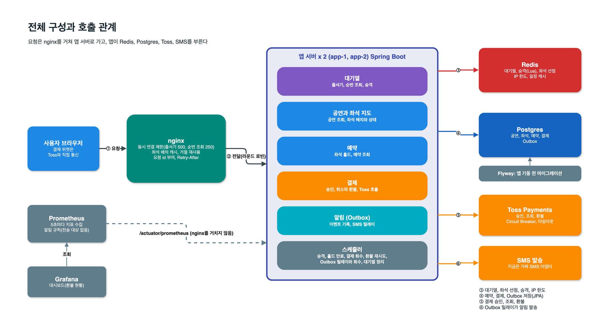
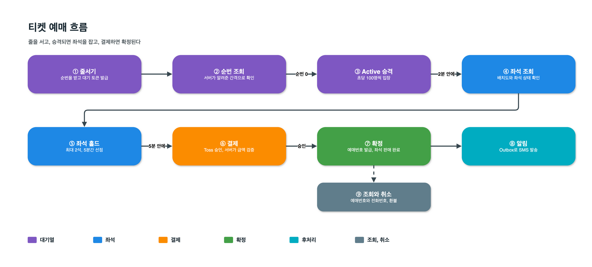
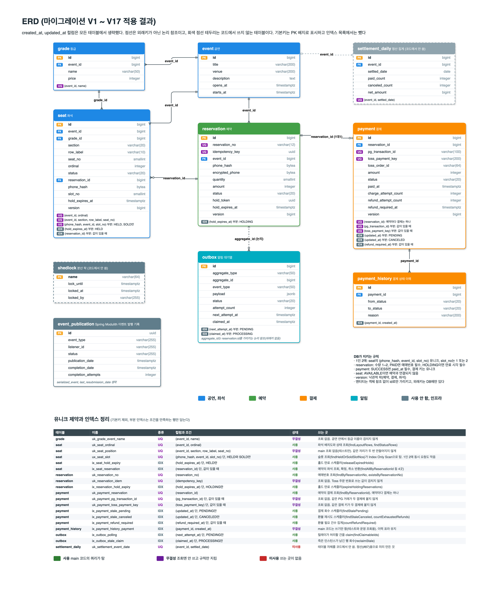

# 티켓 예매 시스템

오픈런 트래픽을 견디는 콘서트 티켓 예매 시스템. 비회원 지정석 판매를 기준으로, 몰려드는 요청이 DB에 닿기 전에 Redis 대기열에서 흡수하고 동시 요청에서도 좌석 정합성을 지키는 것을 목표로 한다.

- **대기열로 DB를 보호한다.** 대기자 50만 명은 Redis가 받고, DB를 쓰는 사람은 승격된 사람뿐이다(초당 100명).
- **좌석의 최종 판정은 PostgreSQL이 한다.** 같은 좌석은 한 명에게만 팔린다.
- **측정한 것과 못 한 것을 같이 적는다.** 동시성 테스트, e2e 31개, k6 부하 측정(한 대의 Mac, 가짜 PG)을 했다.
  목표 규모 전체를 한꺼번에 건 측정은 4번 중 1번만 모든 SLO를 충족했다(원인은 `docs/slo.md`).

기능을 넓히기보다 하나의 예매 흐름을 끝까지 구현하고, 설계 판단은 부하 테스트와 동시성 테스트로 검증한다.

---

## 한눈에 보기





```
대기열 등록 -> 순번 조회 -> 승격 -> 좌석 선택과 홀드 -> 결제 -> 예매번호 발급
```

예매 후 예매번호와 전화번호로 조회하고 취소할 수 있다.

---

## 목표와 규모

1. 대량 접속을 대기열로 흡수한다.
2. 같은 좌석이 중복 판매되지 않도록 한다.
3. 결제와 좌석 상태의 정합성을 보장한다.
4. 중복 요청을 멱등하게 처리한다.
5. 외부 장애가 전체 예매 흐름으로 전파되지 않도록 한다.
6. 실패한 작업을 재시도하고 재처리할 수 있도록 한다.

| 항목 | 목표 |
| --- | --- |
| 좌석 | 30,000석 |
| 최대 대기열 유입 | 500,000명 |
| 대기열 등록 | 2,000 TPS |
| 승격 및 DB 반영 | 100 TPS |

목표 수치는 가정치다. "50만 명"은 대기열에 서 있는 사람의 수이지 동시에 처리하는 수가 아니다. 서버 증설이 필요한지는 [`docs/capacity.md`](docs/capacity.md)에 정리했다.

---

## 핵심 설계

### 1. 대기열: 몰리는 요청이 DB에 닿지 않게 한다

예매 오픈 순간 수십만 명이 좌석 조회, 홀드, 결제를 한꺼번에 시도하면 DB 연결 풀(20개)과 행 잠금이 먼저 한계에 닿는다. 그래서 접속자는 모두 Redis 대기열에 줄을 세우고, 앱이 DB를 쓰는 사람 수를 초당 100명으로 조절한다.

| 단계 | 동작 |
| --- | --- |
| 줄서기 | Lua 한 번으로 오픈 전, 공연 시작 뒤, 대기열 50만 도달, IP별 발급 한도를 판정한다. 통과하면 순번을 주고 대기 ZSET에 넣는다. 시각은 Redis 시계로 판정한다 |
| 순번 조회 | 클라이언트가 앱의 `GET /api/events/{id}/queues/me`를 폴링하고, 앱이 Redis를 읽어 순번을 돌려준다. 조회가 곧 생존 신호다(토큰 TTL 15분이 늘어남) |
| 승격 | 1초마다 앞사람부터 최대 100명에게 활성 토큰(TTL 2분)을 준다. 예산은 Redis 시계의 초 단위 키로 세므로 앱이 여러 대여도 합계가 100을 넘지 않는다. 토큰이 만료된 사람은 건너뛴다 |
| 홀드 | 활성 토큰만 좌석을 잡을 수 있고, 토큰은 하나의 전화번호에 묶인다 |

순번 조회의 경로와 응답은 다음과 같다.

- 경로: 클라이언트 -> nginx -> 앱 -> Redis. 클라이언트는 Redis에 직접 붙지 않는다.
- 요청 헤더는 `X-Queue-Token`이고, 응답은 `rank`, `nextPollIntervalMs`, `soldOut`이다.
- `rank`는 내 순번에서 마지막 승격 순번을 뺀 값이다. 승격되면 0이다.
- 다음 조회 간격은 서버가 정한다. 100위 안은 2초, 그 밖은 15초에서 5분이다(지터 ±20%).

규모와 근거는 다음과 같다.

- 대기자 50만 명이 쓰는 Redis 메모리는 약 100~112MiB다.
- DB를 쓰는 것은 승격된 사람뿐이라 DB 부하는 대기자 수가 아니라 승격 속도가 정한다.
- 대기열은 많은 사람을 한꺼번에 처리하는 구조가 아니라 속도를 조절하는 구조다. 대기자 대부분은 매진 전에 승격되지 못한다.
- 앱 1대(2코어)로 목표 규모 전체를 걸었을 때 Postgres CPU 평균은 21~32%, Redis는 13~15%였다(병목이 아님).
- 초당 100명은 DB 한계에서 계산한 값이 아니라 목표로 둔 가정치다. 사후에 확인한 근거는 다음과 같다.
  - 동시에 좌석을 고르는 사람은 최대 약 12,000명(100 x 활성 TTL 120초)으로 좌석 30,000석과 같은 자릿수다.
  - 3만 석이 다 팔리는 데 150~300초(1인 1~2매)가 걸린다.
  - 측정에서 DB는 한계가 아니었다(홀드 p95 3~6ms).
  - 속도를 올려 가며 한계를 찾는 측정은 하지 않았다.

### 2. 좌석 정합성: Redis는 거르고, 최종 판정은 PostgreSQL

- 홀드는 Redis로 먼저 선점해서 충돌할 요청이 DB 연결을 잡지 않게 하고, 통과한 요청만 DB 트랜잭션의 조건부 UPDATE(`WHERE status = 'AVAILABLE'`)로 확정한다. Redis를 좌석의 최종 판정자로 쓰지 않는다.
- 최대 2석을 한 번에 잡고(all-or-nothing), 1인 2매 제한은 DB의 부분 유니크 인덱스가 최종 방어한다(동시 요청에도 뚫리지 않는다).
- 홀드는 5분 뒤 만료되고(결제가 거절되면 1분으로 단축), 만료 스위퍼가 30초마다 좌석을 되돌린다.

### 3. 결제와 멱등성

- 예약마다 결제는 하나다(`uk_payment_reservation`). PG를 부르기 전에 결제를 PENDING으로 선점하고, 같은 결제에 겹친 요청은 낙관적 락 충돌로 걸려 409로 응답한다.
- Toss 호출의 `Idempotency-Key`는 예약의 멱등키에 시도 횟수를 섞어 만든다.
  - Toss는 거절 응답도 같은 키로 재생한다. 키를 고정하면 새 카드로 시도해도 첫 거절이 돌아온다.
  - 키를 바꿔도 이중 청구와 이중 환불은 Toss가 막는다.
- PG 응답을 못 받은 PENDING 결제는 회수 스케줄러가 PG 조회로 정리한다(이미 승인됐으면 확정한다).
- 결제 확정은 한 트랜잭션에서 예약 PAID, 예매번호 발급, 좌석 SOLD, 결제 SUCCESS, Outbox 기록을 함께 처리한다.
- PG 호출에는 Circuit Breaker를 둔다(gateway가 `toss`일 때).

### 4. Outbox

- 확정과 취소의 같은 트랜잭션에서 Outbox에 기록한다.
- 릴레이가 `FOR UPDATE SKIP LOCKED`로 행을 가져가므로 앱이 여러 대여도 동시에 같은 행을 잡지 않는다.
- 실패하면 30초 간격으로 최대 5회 재시도하고 이후 FAILED로 남긴다.
- 죽은 인스턴스가 잡고 있던 행은 60초 뒤 회수한다.
- 전달은 최소 한 번(at-least-once)이다. 발송 직후 완료 처리 전에 인스턴스가 죽으면 회수 뒤 같은 알림이 한 번 더 나갈 수 있다. 실제 SMS 벤더를 붙일 때는 수신 측이 중복을 견뎌야 한다.
- SMS 게이트웨이는 가짜 어댑터이고 실제 벤더는 연동하지 않았다.

### 5. 읽기와 과부하 보호

| 보호 | 동작 |
| --- | --- |
| nginx 동시 연결 상한 | 줄서기 500, 순번 조회 250을 넘으면 앱에 보내지 않고 503(`SERVER_BUSY`)과 `Retry-After`(3~10초 분산)로 거절한다 |
| 거절 재사용 | 대기열이 가득 차 앱이 거절(503 `QUEUE_FULL`)하면 `Cache-Control`을 붙이고, nginx가 1~2초 같은 응답을 대신 돌려준다. 거절 요청당 앱 CPU가 0.273ms에서 0.009~0.032ms로 줄었다 |
| 연결 풀 고갈 | DB 연결 풀이 고갈되면 500이 아니라 503과 `Retry-After`로 응답한다 |
| 좌석 배치 캐시 | 좌석 배치 응답을 nginx가 캐시한다. 앱 CPU 평균이 93~147%에서 49~53%로 줄었다 |
| 좌석 상태 비트맵 | 좌석당 2비트로 인코딩한 스냅샷을 앱 메모리에 두고 1초마다 갱신한다(3만 석 응답 약 10KB). 읽기 요청이 DB를 쓰지 않는다 |

### 6. Kafka를 쓰지 않는 이유

v1은 Outbox와 DB 폴링으로 충분하다. 소비자가 SMS 게이트웨이 하나라 팬아웃 이점이 없다.

---

## 데이터 모델



- 한 사람이 한 공연에서 잡을 수 있는 좌석은 2석까지다. `seat`의 `(phone_hash, event_id, slot_no)`에 부분 유니크 인덱스(HELD, SOLD만 대상)를 두었고, 취소와 만료된 좌석은 빠져서 슬롯이 비워진다.
- 예약, 결제, 좌석은 `version` 컬럼으로 낙관적 락을 쓴다.
- 엔티티는 객체 참조 없이 id로만 서로를 가리킨다. 모듈 경계는 Spring Modulith 검증 테스트가 지킨다.

---

## 구현 범위

| 영역 | 구현 | 미구현, 한계 |
| --- | --- | --- |
| 대기열 | 선착순 대기열, 순번 조회, 초당 100명 승격, 이탈자 정리(만료된 토큰은 승격 때 건너뜀), 줄서기 IP 제한(분당 100) | |
| 좌석 | 배치도 조회, 상태 비트맵, 최대 2석 all-or-nothing 홀드, 홀드 만료 | 결제 전 좌석 변경 |
| 결제 | `fake`/`toss` PG 선택, 서버 측 금액 검증, 멱등키, Circuit Breaker, 결제 실패 보상, PENDING 회수 | |
| 취소와 후처리 | 예약 취소, 좌석 반환, 환불 재시도(첫 시도 포함 최대 5회, 이후 ERROR로 알려 수동 처리), Outbox 재시도 | 실제 SMS 벤더 연동, FAILED 작업을 되살리는 도구 |
| 보호 | 1인 2매, 예매 조회와 취소의 예매번호별, IP별 시도 제한, nginx 동시 연결 상한, 표준 에러 응답, Trace ID | 전역 API 요청 제한, 매진 Kill Switch |
| 운영 | Prometheus 지표, 환불 Grafana 대시보드(1개), 환불 대기 알림 규칙, 느린 요청 로그 | Alertmanager(알림 전달), 프론트 |

---

## 검증 결과

| 구분 | 방법 | 결과 |
| --- | --- | --- |
| 단위, 통합 | JUnit 5, MockK, Testcontainers, WireMock. `./gradlew build`에 ktlint, detekt, 모듈 경계 검사가 포함된다 | 937건 통과 (동시성, e2e 제외, 2026-11-05) |
| 동시성 | `@Tag("concurrency")` 10개 클래스(좌석 홀드, 결제 확정, 예매 조회 제한, 홀드 만료, Outbox, 대기열 등) | `./gradlew concurrencyTest`. main 병합과 야간 CI에서 실행 |
| e2e | 실제 HTTP, Redis, PostgreSQL로 앱 전체를 거치는 시나리오 31개(자동화 30개, 수동 스크립트 1개). main 병합과 야간에 CI 실행 | [`docs/e2e/scenarios.md`](docs/e2e/scenarios.md) |
| 부하, 흐름 | k6, 앱 1대(2코어), 가짜 PG. 줄서기 2,000/s, 순번 조회 3,000/s, 흐름 40~120명/s와 읽기 300/s | 모든 SLO 충족. 홀드 p95 3~6ms, 결제 p95 6~8ms |
| 부하, 목표 규모 전체 | 대기자 50만 명에 순번 조회 3,200/s, 줄서기 2,000/s, 승격 100/s의 홀드와 결제, 읽기 300/s를 동시에 | 4회 중 1회만 모든 SLO 충족. 나머지는 순번 조회 가용성 95.57~99.03%(nginx 상한 503). 예열 없음 1회는 공연 목록, 상세, 예약 조회 p99도 위반 |
| 정합성 | 부하 뒤 DB 점검 | 기록된 실행(`docs/slo.md`)에서 어긋난 확정 예약 0건, 1분 넘은 PENDING 결제 0건. 최종 V2 재측정 4회는 기록이 없어 제외 |
| 장애 | PG 장애(WireMock 5xx, 서킷 OPEN), Toss 호환 스텁의 지연과 5xx 부하, Redis 재시작 후 회복. 실제 Toss 샌드박스로 승인, 환불, 거절 뒤 재시도를 수동 확인 | |

### 한계

- 부하 측정은 한 대의 Mac에서 부하기와 서버가 함께 돌았고, 조건당 1~2회이며 PG는 가짜다.
- Redis는 단일 노드다(Sentinel, Cluster 없음). 내려가 있는 동안 줄서기, 순번 조회, 홀드는 503으로 거절된다.
- Redis를 재시작하면 AOF로 대기열이 복원된다. 좌석의 최종 판정은 DB라 이중 판매는 없다.
- Redis 장애, 결제 연속 실패, Outbox 처리 실패의 부하 측정은 하지 않았다.
- 실제 ALB, 실제 Toss의 지연, 실제 50만 명의 재시도 패턴은 재지 못했다.

### 검증하지 않는 것

로컬 컨테이너 2개는 프로세스 분리는 재현하지만 실제 다중 노드 환경은 아니다. 아래는 설계 근거로만 남기고 실측 검증은 하지 않는다.

- 로컬 캐시 편차: 좌석 상태 스냅샷과 매진 여부는 앱 인스턴스마다 메모리에 있고 nginx는 좌석 배치만 캐시한다. 인스턴스 사이에 최대 몇 초 차이가 날 수 있지만 홀드는 DB가 판정하므로 정합성에는 영향이 없다.
- 인스턴스 강제 종료 시 락 해제와 인계
- 네트워크 파티션과 실제 인프라 장애

---

## 문서

| 문서 | 내용 |
| --- | --- |
| [`docs/slo.md`](docs/slo.md) | API별 SLO, 측정 방법, 실측 결과와 원인 분석 |
| [`docs/capacity.md`](docs/capacity.md) | "50만 명"의 의미, 앱 1대의 자원 사용, 서버 증설이 필요한 이유 |
| [`docs/slow-requests.md`](docs/slow-requests.md) | 느린 요청을 nginx와 앱 로그로 추적하는 방법 |
| [`docs/e2e/scenarios.md`](docs/e2e/scenarios.md) | e2e 시나리오 목록 |
| [`docs/runbook/`](docs/runbook/) | PG 전환, 환불 수동 처리, Redis 장애 대응 |
| [`docs/diagrams/`](docs/diagrams/) | 다이어그램 PNG 7장(호출 순서, 거절 분기, 상태 전이 포함) |
| [`k6/README.md`](k6/README.md) | 부하 측정 스크립트와 실행 방법 |

---

## 실행 방법

인프라만 컨테이너로 띄우고 앱은 로컬에서 직접 실행한다.

```bash
# 1. 환경 변수 준비
cp .env.example .env   # PHONE_HMAC_KEY, PHONE_ENCRYPTION_KEY, TOSS_SECRET_KEY, GRAFANA_ADMIN_PASSWORD 채우기
                       # (TOSS_SECRET_KEY는 TICKET_RUSH_PAYMENT_GATEWAY=toss일 때만 필요하다. 키 없이 toss로 켜면 기동 때 실패한다.
                       #  local 프로필의 기본값은 fake다)
                       # local 프로필은 앱이 이 .env를 직접 읽는다. 작업 디렉터리가 프로젝트 루트여야 하므로
                       # 인텔리제이는 실행 설정의 Working directory를 확인한다

# 2. 인프라 기동 (PostgreSQL, Redis, Flyway 마이그레이션)
docker compose up -d

# 3. 앱 실행 (IDE 또는 CLI, local 프로필이 기본값)
./gradlew bootRun
```

앱은 Flyway를 직접 돌리지 않고(`flyway.enabled: false`) 전용 컨테이너가 마이그레이션을 실행한다. 앱 2대가 동시에 기동해도 마이그레이션이 겹치지 않게 하려는 것이다.

Prometheus와 Grafana까지 같이 보려면 `docker compose --profile observability up -d`.

전체 빌드 검증(컴파일, 테스트, detekt, ktlint, 모듈 경계 검사):

```bash
./gradlew build
```

앱 2대와 nginx로 다중 인스턴스를 띄우려면:

```bash
docker compose -f docker-compose.yml -f docker-compose.app.yml up -d --build
```

실제 다중 노드가 아니라 동일 호스트의 컨테이너 2개이며, PostgreSQL과 Redis는 단일 인스턴스다.

---

## 기술 스택

| 구분 | 기술 |
| --- | --- |
| Language, Runtime | Kotlin 2.4, JDK 25 |
| Framework | Spring Boot 4.1, Spring Modulith |
| Database | PostgreSQL 18, Spring Data JPA, Flyway |
| Cache, Queue | Redis 8, Lettuce, Lua 스크립트 |
| Reliability | Resilience4j(Circuit Breaker), Outbox |
| Test | JUnit 5, MockK, Testcontainers, WireMock, k6 |
| Monitoring | Actuator, Micrometer, Prometheus, Grafana |
| Infrastructure | Docker Compose, nginx |
